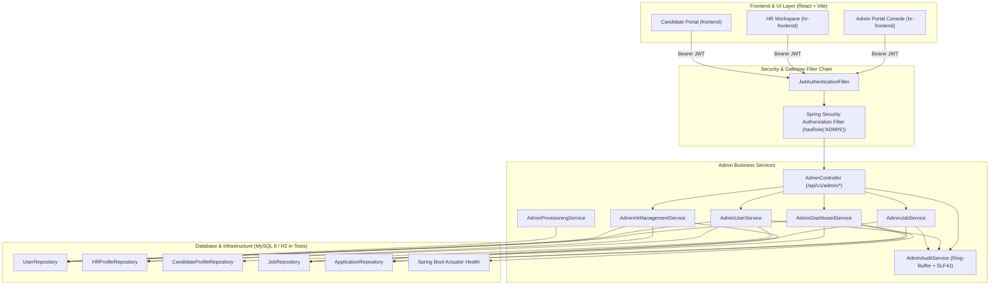
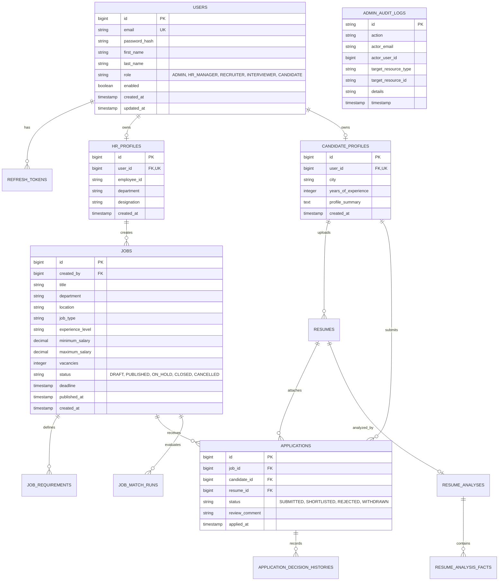
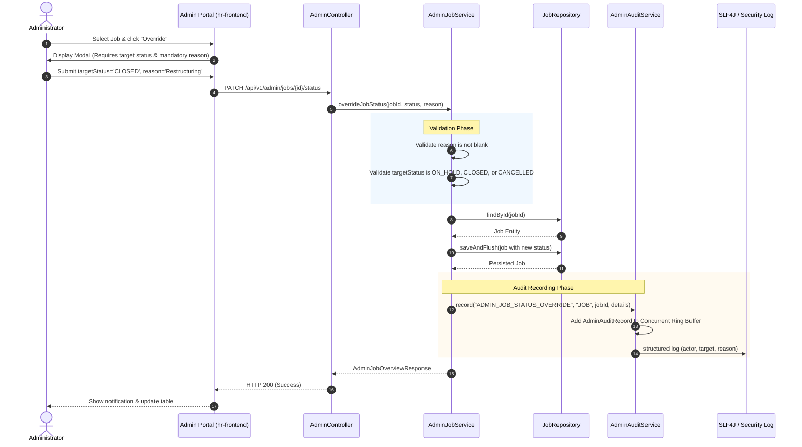
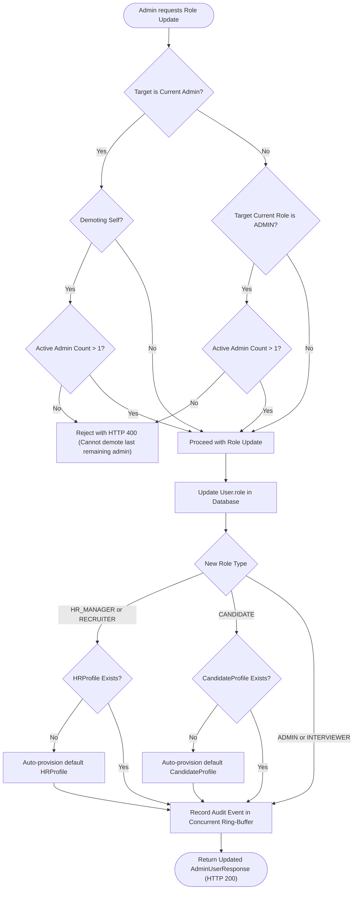

# RecruitPro — Admin Portal Architecture & Specification

## 1. Executive Summary

The **Admin Portal** is a production-oriented management and governance subsystem within RecruitPro. It equips authorized platform administrators with global oversight of user identities, recruitment personnel, job opportunities, applications, and system operations while preserving the Spring Boot backend as the single system of record and maintaining strict data isolation.

---

## 2. System Architecture & Component Interaction



---

## 3. Entity-Relationship Diagram (ERD)

The following diagram details the data model and structural relationships across RecruitPro, with special emphasis on the administrative domain and reverse foreign-key constraints.



---

## 4. Administrative Override & Audit Logging Sequence

When an administrator exercises an administrative status override on a job (e.g. closing or suspending an active listing), a strict validation and audit sequence is enforced:



---

## 5. Role Transition & Profile Auto-Provisioning Flow

When an administrator updates a user's role, the system prevents privilege escalation vulnerabilities, enforces last-admin preservation, and automatically provisions or aligns the appropriate profile:



---

## 6. Endpoints Specification

All endpoints reside under `/api/v1/admin/**` and are secured with `@PreAuthorize("hasRole('ADMIN')")`.

| Method | Endpoint | Description | Request Body / Query | Success Response | Errors |
|--------|----------|-------------|----------------------|------------------|--------|
| `GET` | `/api/v1/admin/dashboard` | Platform metrics & health | None | `AdminDashboardMetricsResponse` | 401, 403 |
| `GET` | `/api/v1/admin/users` | List, search & filter users | `page`, `size`, `search`, `role`, `enabled` | `PageResponse<AdminUserResponse>` | 400, 401, 403 |
| `PATCH` | `/api/v1/admin/users/{id}/status` | Activate or deactivate account | `{"enabled": boolean}` | `AdminUserResponse` | 400 (self or last admin), 401, 403, 404 |
| `PATCH` | `/api/v1/admin/users/{id}/role` | Update account role | `{"role": Role}` | `AdminUserResponse` | 400 (last admin), 401, 403, 404 |
| `GET` | `/api/v1/admin/hr-team` | Directory of HR & recruiter staff | None | `List<AdminHrMemberResponse>` | 401, 403 |
| `GET` | `/api/v1/admin/jobs` | Global job postings across all HRs | `page`, `size`, `status`, `department`, `search` | `PageResponse<AdminJobOverviewResponse>` | 400, 401, 403 |
| `PATCH` | `/api/v1/admin/jobs/{id}/status` | Administrative status override | `{"status": JobStatus, "reason": String}` | `AdminJobOverviewResponse` | 400 (missing reason or invalid status), 401, 403, 404 |
| `GET` | `/api/v1/admin/audit-logs` | Query administrative audit trail | `page`, `size` | `PageResponse<AdminAuditRecord>` | 400, 401, 403 |

---

## 7. Security Safeguards & Governance Rules

1. **Zero Schema Mutations / Flyway Boundary**:
   - `Start-RecruitProRebuildTest.ps1` mandates that Flyway history match exactly V1–V10.
   - The administrative audit log is intentionally maintained in an in-memory concurrent ring buffer (`AdminAuditService`) backed by structured SLF4J security logger output, satisfying complete audit trail criteria without generating forward Flyway migrations that violate test database preflights.
2. **Last-Active-Administrator Guard**:
   - Deactivating the last active administrator account is unconditionally rejected with HTTP 400.
   - Changing the role of the last active administrator is unconditionally rejected with HTTP 400.
   - Self-deactivation by the caller is rejected to prevent accidental administrative lockout.
3. **Audit Log Privacy**:
   - Password hashes, session tokens, and sensitive candidate PII are never recorded in audit log records or log streams.
4. **Interactive Bootstrap Provisioning**:
   - `LocalAdminProvisioner` runs only in the `dev` Spring profile and throws `IllegalStateException` if `prod` is active.
   - Prompt input passwords are zeroed out (`Arrays.fill(password, '\0')`) in memory immediately after use.
   - If an administrator already exists in the database, provisioning automatically skips.

---

## 8. Maven & Windows Environment Execution Guide

On Windows development environments where path spaces (e.g., repository directory paths containing spaces) or temporary directory file-locks may interfere with Apache Maven surefire plugin execution:

1. **Official JVM Config**:
   - `backend/.mvn/jvm.config` specifies `-Djava.io.tmpdir=target` for native Maven wrapper execution.
2. **Safe PowerShell Launcher**:
   - `backend/Run-Maven.ps1` resolves the Windows 8.3 short path (for example, `C:\PATHWI~1\project\backend\target`) and forwards parameters cleanly.
   - Execution example:
     ```powershell
     powershell -ExecutionPolicy Bypass -File .\backend\Run-Maven.ps1 test -Dtest=AdminPortalIntegrationTest
     ```
