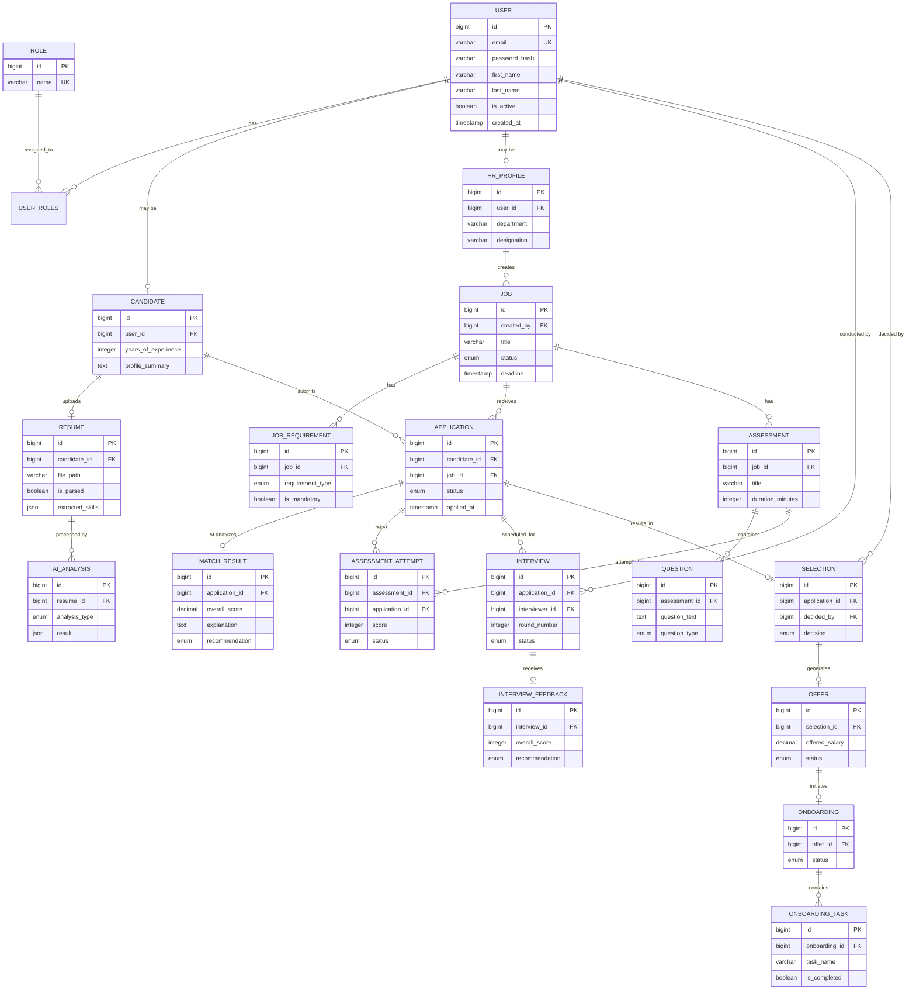

# Entity-Relationship Documentation

## AI-Powered Recruitment & Hiring Management Platform

**Version:** 1.0  
**Phase:** 0 — Architecture & Foundation

---

## 1. Entity Overview

| # | Entity | Module | Purpose |
|---|--------|--------|---------|
| 1 | User | Auth | Base user account for all actors |
| 2 | Role | Auth | Role definition (ADMIN, HR_MANAGER, RECRUITER, INTERVIEWER, CANDIDATE) |
| 3 | Candidate | Candidate | Extended profile for job seekers |
| 4 | HRProfile | HR | Extended profile for HR personnel |
| 5 | Job | HR | Job posting with details and requirements |
| 6 | JobRequirement | HR | Specific skill/qualification requirements for a job |
| 7 | Resume | Candidate | Uploaded resume file and extracted metadata |
| 8 | Application | Application | A candidate's application to a specific job |
| 9 | AIAnalysis | AI | AI processing result for a resume |
| 10 | MatchResult | AI | AI-computed match between a candidate and a job |
| 11 | Assessment | Assessment | Assessment/test linked to a job or application |
| 12 | Question | Assessment | Individual question within an assessment |
| 13 | AssessmentAttempt | Assessment | A candidate's attempt at an assessment |
| 14 | Interview | Interview | Scheduled interview session |
| 15 | InterviewFeedback | Interview | Interviewer's evaluation of a candidate |
| 16 | Selection | Hiring | Selection decision for an application |
| 17 | Offer | Hiring | Formal job offer issued to a selected candidate |
| 18 | Onboarding | Onboarding | Onboarding process for an accepted candidate |
| 19 | OnboardingTask | Onboarding | Individual task/checklist item in onboarding |

---

## 2. Entity Definitions & Relationships

### 2.1 User

**Module:** Auth  
**Purpose:** Base authentication entity for every person who uses the system.

| Field | Type | Constraints |
|-------|------|------------|
| id | BIGINT | PK, AUTO_INCREMENT |
| email | VARCHAR(255) | UNIQUE, NOT NULL |
| password_hash | VARCHAR(255) | NOT NULL |
| first_name | VARCHAR(100) | NOT NULL |
| last_name | VARCHAR(100) | NOT NULL |
| phone | VARCHAR(20) | NULLABLE |
| is_active | BOOLEAN | DEFAULT TRUE |
| email_verified | BOOLEAN | DEFAULT FALSE |
| created_at | TIMESTAMP | NOT NULL |
| updated_at | TIMESTAMP | NOT NULL |

**Relationships:**
- User → Many Roles (via user_roles join table)
- User → Zero or One Candidate (if the user is a candidate)
- User → Zero or One HRProfile (if the user is HR)

---

### 2.2 Role

**Module:** Auth  
**Purpose:** Defines access levels within the system.

| Field | Type | Constraints |
|-------|------|------------|
| id | BIGINT | PK, AUTO_INCREMENT |
| name | VARCHAR(50) | UNIQUE, NOT NULL |
| description | VARCHAR(255) | NULLABLE |

**Predefined Values:**
- ROLE_ADMIN
- ROLE_HR_MANAGER
- ROLE_RECRUITER
- ROLE_INTERVIEWER
- ROLE_CANDIDATE

**Relationships:**
- Role → Many Users (via user_roles join table)

---

### 2.3 Candidate

**Module:** Candidate  
**Purpose:** Extended profile for users who are job seekers.

| Field | Type | Constraints |
|-------|------|------------|
| id | BIGINT | PK, AUTO_INCREMENT |
| user_id | BIGINT | FK → User, UNIQUE, NOT NULL |
| date_of_birth | DATE | NULLABLE |
| gender | VARCHAR(20) | NULLABLE |
| address | TEXT | NULLABLE |
| city | VARCHAR(100) | NULLABLE |
| state | VARCHAR(100) | NULLABLE |
| country | VARCHAR(100) | NULLABLE |
| zip_code | VARCHAR(20) | NULLABLE |
| linkedin_url | VARCHAR(500) | NULLABLE |
| portfolio_url | VARCHAR(500) | NULLABLE |
| years_of_experience | INTEGER | NULLABLE |
| current_company | VARCHAR(255) | NULLABLE |
| current_designation | VARCHAR(255) | NULLABLE |
| expected_salary | DECIMAL(12,2) | NULLABLE |
| notice_period_days | INTEGER | NULLABLE |
| profile_summary | TEXT | NULLABLE |
| created_at | TIMESTAMP | NOT NULL |
| updated_at | TIMESTAMP | NOT NULL |

**Relationships:**
- Candidate → One User (FK: user_id)
- Candidate → Zero or One Resume
- Candidate → Many Applications

---

### 2.4 HRProfile

**Module:** HR  
**Purpose:** Extended profile for HR personnel.

| Field | Type | Constraints |
|-------|------|------------|
| id | BIGINT | PK, AUTO_INCREMENT |
| user_id | BIGINT | FK → User, UNIQUE, NOT NULL |
| employee_id | VARCHAR(50) | UNIQUE, NULLABLE |
| department | VARCHAR(100) | NULLABLE |
| designation | VARCHAR(100) | NULLABLE |
| created_at | TIMESTAMP | NOT NULL |
| updated_at | TIMESTAMP | NOT NULL |

**Relationships:**
- HRProfile → One User (FK: user_id)
- HRProfile → Many Jobs (as creator)

---

### 2.5 Job

**Module:** HR  
**Purpose:** A job posting created by HR.

| Field | Type | Constraints |
|-------|------|------------|
| id | BIGINT | PK, AUTO_INCREMENT |
| created_by | BIGINT | FK → HRProfile, NOT NULL |
| title | VARCHAR(255) | NOT NULL |
| description | TEXT | NOT NULL |
| department | VARCHAR(100) | NULLABLE |
| location | VARCHAR(255) | NULLABLE |
| job_type | ENUM | FULL_TIME, PART_TIME, CONTRACT, INTERNSHIP |
| experience_level | ENUM | ENTRY, MID, SENIOR, LEAD, EXECUTIVE |
| min_salary | DECIMAL(12,2) | NULLABLE |
| max_salary | DECIMAL(12,2) | NULLABLE |
| vacancies | INTEGER | DEFAULT 1 |
| status | ENUM | DRAFT, PUBLISHED, CLOSED, ON_HOLD, CANCELLED |
| published_at | TIMESTAMP | NULLABLE |
| deadline | TIMESTAMP | NULLABLE |
| created_at | TIMESTAMP | NOT NULL |
| updated_at | TIMESTAMP | NOT NULL |

**Relationships:**
- Job → One HRProfile (FK: created_by)
- Job → Many JobRequirements
- Job → Many Applications
- Job → Many Assessments

---

### 2.6 JobRequirement

**Module:** HR  
**Purpose:** Specific skill, qualification, or requirement for a job.

| Field | Type | Constraints |
|-------|------|------------|
| id | BIGINT | PK, AUTO_INCREMENT |
| job_id | BIGINT | FK → Job, NOT NULL |
| requirement_type | ENUM | SKILL, EDUCATION, CERTIFICATION, EXPERIENCE, OTHER |
| description | VARCHAR(500) | NOT NULL |
| is_mandatory | BOOLEAN | DEFAULT TRUE |
| min_years | INTEGER | NULLABLE |

**Relationships:**
- JobRequirement → One Job (FK: job_id)

---

### 2.7 Resume

**Module:** Candidate  
**Purpose:** Uploaded resume file and AI-extracted metadata.

| Field | Type | Constraints |
|-------|------|------------|
| id | BIGINT | PK, AUTO_INCREMENT |
| candidate_id | BIGINT | FK → Candidate, UNIQUE, NOT NULL |
| file_name | VARCHAR(255) | NOT NULL |
| file_path | VARCHAR(500) | NOT NULL |
| file_type | VARCHAR(50) | NOT NULL |
| file_size | BIGINT | NOT NULL |
| uploaded_at | TIMESTAMP | NOT NULL |
| is_parsed | BOOLEAN | DEFAULT FALSE |
| parsed_at | TIMESTAMP | NULLABLE |
| extracted_text | TEXT | NULLABLE |
| extracted_skills | JSON | NULLABLE |
| extracted_education | JSON | NULLABLE |
| extracted_experience | JSON | NULLABLE |

**Relationships:**
- Resume → One Candidate (FK: candidate_id)
- Resume → Zero or Many AIAnalysis

---

### 2.8 Application

**Module:** Application  
**Purpose:** Represents a candidate's application to a specific job.

| Field | Type | Constraints |
|-------|------|------------|
| id | BIGINT | PK, AUTO_INCREMENT |
| candidate_id | BIGINT | FK → Candidate, NOT NULL |
| job_id | BIGINT | FK → Job, NOT NULL |
| status | ENUM | SUBMITTED, UNDER_REVIEW, SHORTLISTED, ASSESSMENT, INTERVIEW, SELECTED, OFFERED, HIRED, REJECTED, WITHDRAWN |
| cover_letter | TEXT | NULLABLE |
| applied_at | TIMESTAMP | NOT NULL |
| updated_at | TIMESTAMP | NOT NULL |

**Constraints:**
- UNIQUE(candidate_id, job_id) — a candidate can apply to a job only once.

**Relationships:**
- Application → One Candidate (FK: candidate_id)
- Application → One Job (FK: job_id)
- Application → Zero or One MatchResult
- Application → Zero or Many AssessmentAttempts
- Application → Zero or Many Interviews
- Application → Zero or One Selection

---

### 2.9 AIAnalysis

**Module:** AI  
**Purpose:** Result of AI processing on a resume.

| Field | Type | Constraints |
|-------|------|------------|
| id | BIGINT | PK, AUTO_INCREMENT |
| resume_id | BIGINT | FK → Resume, NOT NULL |
| analysis_type | ENUM | RESUME_PARSE, SKILL_EXTRACTION, EXPERIENCE_ANALYSIS |
| result | JSON | NOT NULL |
| confidence_score | DECIMAL(5,4) | NULLABLE |
| processed_at | TIMESTAMP | NOT NULL |

**Relationships:**
- AIAnalysis → One Resume (FK: resume_id)

---

### 2.10 MatchResult

**Module:** AI  
**Purpose:** AI-computed match between a candidate application and a job.

| Field | Type | Constraints |
|-------|------|------------|
| id | BIGINT | PK, AUTO_INCREMENT |
| application_id | BIGINT | FK → Application, UNIQUE, NOT NULL |
| overall_score | DECIMAL(5,2) | NOT NULL (0.00 - 100.00) |
| skill_score | DECIMAL(5,2) | NULLABLE |
| experience_score | DECIMAL(5,2) | NULLABLE |
| education_score | DECIMAL(5,2) | NULLABLE |
| explanation | TEXT | NOT NULL |
| recommendation | ENUM | STRONG_MATCH, GOOD_MATCH, MODERATE_MATCH, WEAK_MATCH, NOT_RECOMMENDED |
| matched_skills | JSON | NULLABLE |
| missing_skills | JSON | NULLABLE |
| computed_at | TIMESTAMP | NOT NULL |

**Relationships:**
- MatchResult → One Application (FK: application_id)

---

### 2.11 Assessment

**Module:** Assessment  
**Purpose:** A test or assessment created for a job.

| Field | Type | Constraints |
|-------|------|------------|
| id | BIGINT | PK, AUTO_INCREMENT |
| job_id | BIGINT | FK → Job, NOT NULL |
| title | VARCHAR(255) | NOT NULL |
| description | TEXT | NULLABLE |
| duration_minutes | INTEGER | NOT NULL |
| total_marks | INTEGER | NOT NULL |
| passing_marks | INTEGER | NOT NULL |
| is_active | BOOLEAN | DEFAULT TRUE |
| created_at | TIMESTAMP | NOT NULL |

**Relationships:**
- Assessment → One Job (FK: job_id)
- Assessment → Many Questions
- Assessment → Many AssessmentAttempts

---

### 2.12 Question

**Module:** Assessment  
**Purpose:** Individual question in an assessment.

| Field | Type | Constraints |
|-------|------|------------|
| id | BIGINT | PK, AUTO_INCREMENT |
| assessment_id | BIGINT | FK → Assessment, NOT NULL |
| question_text | TEXT | NOT NULL |
| question_type | ENUM | MCQ, SHORT_ANSWER, CODING, ESSAY |
| options | JSON | NULLABLE (for MCQ) |
| correct_answer | TEXT | NULLABLE |
| marks | INTEGER | NOT NULL |
| order_index | INTEGER | NOT NULL |

**Relationships:**
- Question → One Assessment (FK: assessment_id)

---

### 2.13 AssessmentAttempt

**Module:** Assessment  
**Purpose:** A candidate's attempt at an assessment.

| Field | Type | Constraints |
|-------|------|------------|
| id | BIGINT | PK, AUTO_INCREMENT |
| assessment_id | BIGINT | FK → Assessment, NOT NULL |
| application_id | BIGINT | FK → Application, NOT NULL |
| answers | JSON | NULLABLE |
| score | INTEGER | NULLABLE |
| status | ENUM | NOT_STARTED, IN_PROGRESS, SUBMITTED, EVALUATED |
| started_at | TIMESTAMP | NULLABLE |
| submitted_at | TIMESTAMP | NULLABLE |
| evaluated_at | TIMESTAMP | NULLABLE |

**Relationships:**
- AssessmentAttempt → One Assessment (FK: assessment_id)
- AssessmentAttempt → One Application (FK: application_id)

---

### 2.14 Interview

**Module:** Interview  
**Purpose:** A scheduled interview session.

| Field | Type | Constraints |
|-------|------|------------|
| id | BIGINT | PK, AUTO_INCREMENT |
| application_id | BIGINT | FK → Application, NOT NULL |
| interviewer_id | BIGINT | FK → User, NOT NULL |
| round_number | INTEGER | NOT NULL |
| round_name | VARCHAR(100) | NOT NULL |
| scheduled_at | TIMESTAMP | NOT NULL |
| duration_minutes | INTEGER | DEFAULT 60 |
| location | VARCHAR(255) | NULLABLE |
| meeting_link | VARCHAR(500) | NULLABLE |
| status | ENUM | SCHEDULED, IN_PROGRESS, COMPLETED, CANCELLED, RESCHEDULED |
| notes | TEXT | NULLABLE |
| created_at | TIMESTAMP | NOT NULL |
| updated_at | TIMESTAMP | NOT NULL |

**Relationships:**
- Interview → One Application (FK: application_id)
- Interview → One User as interviewer (FK: interviewer_id)
- Interview → Zero or One InterviewFeedback

---

### 2.15 InterviewFeedback

**Module:** Interview  
**Purpose:** Interviewer's evaluation after an interview.

| Field | Type | Constraints |
|-------|------|------------|
| id | BIGINT | PK, AUTO_INCREMENT |
| interview_id | BIGINT | FK → Interview, UNIQUE, NOT NULL |
| technical_score | INTEGER | NULLABLE (1-10) |
| communication_score | INTEGER | NULLABLE (1-10) |
| cultural_fit_score | INTEGER | NULLABLE (1-10) |
| overall_score | INTEGER | NULLABLE (1-10) |
| strengths | TEXT | NULLABLE |
| weaknesses | TEXT | NULLABLE |
| comments | TEXT | NULLABLE |
| recommendation | ENUM | STRONG_HIRE, HIRE, NO_HIRE, STRONG_NO_HIRE |
| submitted_at | TIMESTAMP | NOT NULL |

**Relationships:**
- InterviewFeedback → One Interview (FK: interview_id)

---

### 2.16 Selection

**Module:** Hiring  
**Purpose:** Final selection decision for an application.

| Field | Type | Constraints |
|-------|------|------------|
| id | BIGINT | PK, AUTO_INCREMENT |
| application_id | BIGINT | FK → Application, UNIQUE, NOT NULL |
| decided_by | BIGINT | FK → User, NOT NULL |
| decision | ENUM | SELECTED, REJECTED, ON_HOLD |
| reason | TEXT | NULLABLE |
| decided_at | TIMESTAMP | NOT NULL |

**Relationships:**
- Selection → One Application (FK: application_id)
- Selection → One User (FK: decided_by)
- Selection (if SELECTED) → Zero or One Offer

---

### 2.17 Offer

**Module:** Hiring  
**Purpose:** Formal offer issued to a selected candidate.

| Field | Type | Constraints |
|-------|------|------------|
| id | BIGINT | PK, AUTO_INCREMENT |
| selection_id | BIGINT | FK → Selection, UNIQUE, NOT NULL |
| offered_salary | DECIMAL(12,2) | NOT NULL |
| offered_designation | VARCHAR(255) | NOT NULL |
| offered_department | VARCHAR(100) | NULLABLE |
| joining_date | DATE | NOT NULL |
| offer_letter_path | VARCHAR(500) | NULLABLE |
| status | ENUM | DRAFT, SENT, ACCEPTED, DECLINED, EXPIRED, REVOKED |
| sent_at | TIMESTAMP | NULLABLE |
| responded_at | TIMESTAMP | NULLABLE |
| expiry_date | DATE | NULLABLE |
| created_at | TIMESTAMP | NOT NULL |
| updated_at | TIMESTAMP | NOT NULL |

**Relationships:**
- Offer → One Selection (FK: selection_id)
- Offer (if ACCEPTED) → Zero or One Onboarding

---

### 2.18 Onboarding

**Module:** Onboarding  
**Purpose:** Onboarding process for an accepted candidate.

| Field | Type | Constraints |
|-------|------|------------|
| id | BIGINT | PK, AUTO_INCREMENT |
| offer_id | BIGINT | FK → Offer, UNIQUE, NOT NULL |
| status | ENUM | NOT_STARTED, IN_PROGRESS, COMPLETED |
| started_at | TIMESTAMP | NULLABLE |
| completed_at | TIMESTAMP | NULLABLE |
| created_at | TIMESTAMP | NOT NULL |
| updated_at | TIMESTAMP | NOT NULL |

**Relationships:**
- Onboarding → One Offer (FK: offer_id)
- Onboarding → Many OnboardingTasks

---

### 2.19 OnboardingTask

**Module:** Onboarding  
**Purpose:** Individual checklist item in the onboarding process.

| Field | Type | Constraints |
|-------|------|------------|
| id | BIGINT | PK, AUTO_INCREMENT |
| onboarding_id | BIGINT | FK → Onboarding, NOT NULL |
| task_name | VARCHAR(255) | NOT NULL |
| description | TEXT | NULLABLE |
| is_completed | BOOLEAN | DEFAULT FALSE |
| due_date | DATE | NULLABLE |
| completed_at | TIMESTAMP | NULLABLE |
| order_index | INTEGER | NOT NULL |

**Relationships:**
- OnboardingTask → One Onboarding (FK: onboarding_id)

---

## 3. ER Diagram (Mermaid)



---

## 4. Module-Entity Ownership

```
Module 1 (Auth)        → User, Role, user_roles
Module 2 (HR)          → HRProfile, Job, JobRequirement
Module 3 (Candidate)   → Candidate, Resume
Module 4 (Application) → Application
Module 5 (AI)          → AIAnalysis, MatchResult
Module 6 (Assessment)  → Assessment, Question, AssessmentAttempt
Module 7 (Interview)   → Interview, InterviewFeedback
Module 8 (Hiring)      → Selection, Offer
Module 9 (Onboarding)  → Onboarding, OnboardingTask
Module 10 (Analytics)  → No owned entities (reads from all modules)
```

---

## 5. Cross-Module Entity Dependencies

| Entity | Owned By | Referenced By |
|--------|----------|--------------|
| User | Auth | Candidate, HRProfile, Interview, Selection |
| Candidate | Candidate | Application |
| Job | HR | Application, Assessment |
| Application | Application | MatchResult, AssessmentAttempt, Interview, Selection |
| Resume | Candidate | AIAnalysis |
| Selection | Hiring | Offer |
| Offer | Hiring | Onboarding |

---

*This ER documentation defines the architectural contract. Actual JPA entity classes will be implemented starting in Phase 1.*
